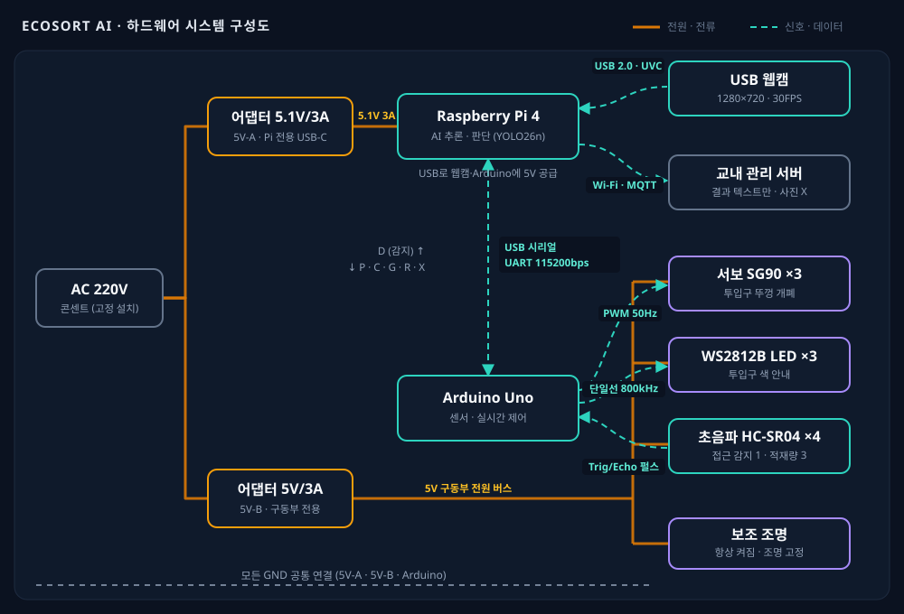
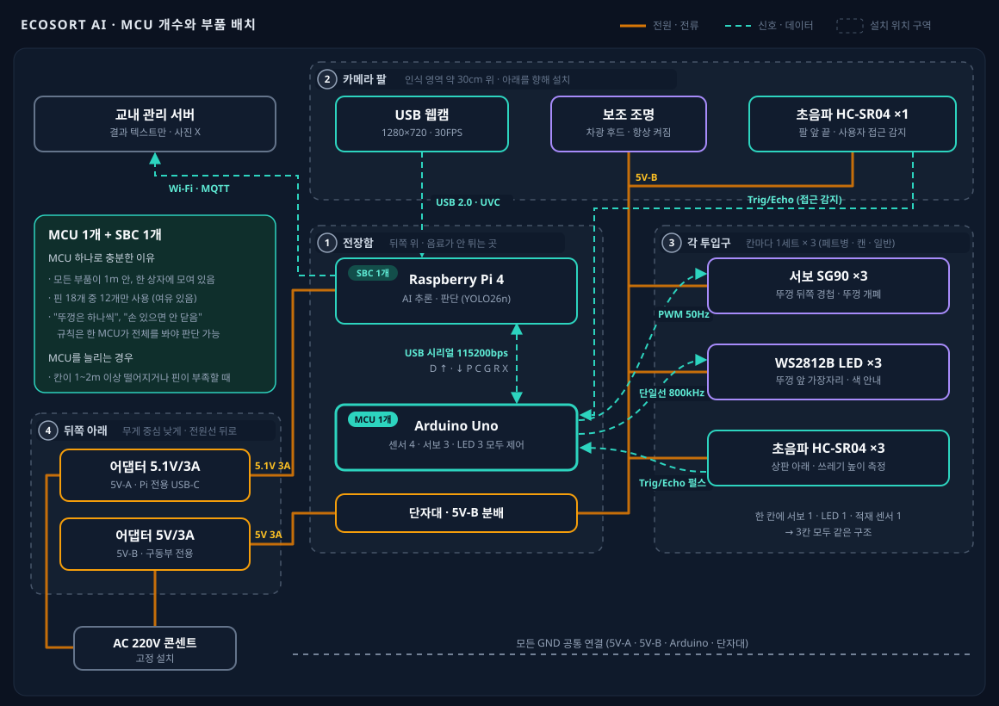

# 하드웨어 시스템 설계서 — AI 분리수거 도우미 스마트 쓰레기통

- 작성자: 이수민
- 작성일: 2026-10-14
- 관련 문서: PRD/PRD_v0.3.md, report/yolo_model.md, code/preprocess_code.py
- 참고: Physical AI 하드웨어 시스템 설계 강의 (전원 → 컴퓨팅 → 입력 → 연결 → 출력 → 통합 순서)
- 기준: 프로토타입 1대. 전압·전류는 각 부품의 일반적인 데이터시트 값이며, 실제 구매한 제품의 데이터시트로 최종 확인한다. 제품마다 차이가 큰 값은 (가정)으로 표시했다.

---

## 0. 설계 원칙

이 제품은 강의에서 다룬 세 가지 원칙을 따른다.

**전압은 맞추고, 전류는 확보한다.** 부품이 요구하는 전압(5.1V, 5V)을 정확히 공급하고, 전류는 평균이 아니라 피크(가장 많이 쓰는 순간)를 기준으로 여유 있게 준비한다.

**AI는 SBC에서, 실시간은 MCU에서.** YOLO26n 추론은 Raspberry Pi 4(SBC)가, 센서 읽기와 뚜껑·LED 제어는 Arduino Uno(MCU)가 맡는다. Pi가 추론하느라 바쁜 순간에도 뚜껑은 정확한 타이밍에 열리고 닫혀야 하기 때문이다.

**MCU는 지시만, 힘은 드라이버가 쓴다.** Arduino는 신호만 보내고, 실제로 힘을 쓰는 서보모터와 LED는 별도 전원에서 전류를 받는다. SG90 서보는 내부에 모터 드라이버가 들어 있어 Arduino의 PWM 신호선만 연결하면 되지만, 전원선은 Arduino가 아닌 구동부 전원에 연결한다.

---

## 1. 전체 구성

이 제품은 **감지 → 판단 → 행동** 흐름으로 동작한다.

감지는 초음파 센서 4개(접근 1, 적재량 3)와 USB 웹캠이 맡는다. 판단은 Raspberry Pi 4가 YOLO26n으로 쓰레기 종류를 판별하고, Arduino Uno가 센서 값으로 상태를 판단한다. 행동은 서보모터 3개(뚜껑)와 RGB LED 3개(투입구 안내)가 맡는다.



주황색 실선은 전원·전류, 청록색 점선은 신호·데이터 흐름이다. 화살표는 데이터가 흐르는 방향을 나타낸다.

---

## 2. 전원 설계 (1교시: 이 시스템은 켜지는가?)

### 2.1 전압 계층

이 제품은 5V 하나의 전압 계층으로 거의 모든 부품을 구성했다. Raspberry Pi 4, 웹캠, Arduino Uno, 서보모터, 초음파 센서, WS2812B LED, 보조 조명이 모두 5V로 동작한다. 12V가 필요한 큰 모터나 펌프가 없어 전원 구성이 단순하다.

3.3V가 쓰이는 곳은 Raspberry Pi의 GPIO 핀과 microSD 카드뿐이다. Pi GPIO는 3.3V 신호라 5V 신호를 직접 넣으면 손상되는데, 이 설계에서는 5V 센서와 구동부를 모두 Arduino(5V 신호)에 연결해 레벨 시프터 없이 이 문제를 피했다.

### 2.2 전원 라인 분리

전원은 두 라인으로 나눈다.

**5V-A (Raspberry Pi 전용)**: 공식 규격 5.1V 3A USB-C 어댑터. Pi와, Pi의 USB 포트에 꽂은 웹캠·Arduino에 공급한다. 추론처럼 계산을 많이 하는 쪽은 전압이 조금만 떨어져도 속도가 느려지거나 재부팅되므로 따로 둔다.

**5V-B (구동부 전용)**: 5V 3A 어댑터. 서보모터 3개, WS2812B LED 3개, 초음파 센서 4개, 보조 조명에 공급한다. 서보모터가 움직이기 시작하는 순간 큰 전류가 갑자기 흐르는데, 이 흔들림이 Pi와 Arduino로 번지지 않도록 분리한다.

두 라인의 **GND는 반드시 한 점에서 연결**한다. 신호는 "GND 대비 몇 V인가"로 읽히기 때문에, 기준(GND)이 다르면 Arduino가 보낸 PWM 신호를 서보가 잘못 읽는다. 단, 두 라인의 +5V끼리는 연결하지 않는다.

### 2.3 왜 서보를 움직이면 보드가 재부팅되는가

서보모터를 Arduino의 5V 핀에서 바로 구동하면, 움직이는 순간 수백 mA가 갑자기 흘러 Arduino 전원 전압이 순간적으로 떨어진다. ATmega328P는 전압이 약 2.7V(브라운아웃 임계값) 아래로 떨어지면 스스로 리셋되므로, 뚜껑이 열릴 때마다 Arduino가 재부팅되고 Pi와의 통신도 끊긴다. 강의에서 다룬 세 조건(모터 전원 분리, 충분한 전류 용량, 공통 GND)을 모두 만족하도록 5V-B 라인을 분리하고, 서보 전원 단자 가까이에 470~1000µF 커패시터를 달고, 서보를 한 번에 하나씩 천천히 움직여 순간 전류를 줄인다.

### 2.4 전력 예산 (평균 / 피크)

전력은 W = V × A로 계산하며, 어댑터는 피크 기준으로 고른다.

**5V-A 라인 (어댑터 용량 5.1V × 3A = 15.3W)**
Raspberry Pi 4는 평균 약 3W(0.6A), 피크 약 7.7W(1.5A, AI 추론 중)다. USB 웹캠은 평균 약 1W(0.2A), 피크 약 2.5W(0.5A)다(가정). Arduino Uno는 평균·피크 모두 약 0.25W(50mA)다. 라인 합계는 **평균 약 4.3W, 피크 약 10.5W**로 용량의 약 69%다. 여유율 30%를 남기는 기준을 만족한다.

**5V-B 라인 (어댑터 용량 5V × 3A = 15W)**
서보모터 3개는 평소 멈춰 있어 평균 약 0.15W, 하나가 움직일 때 약 1.25W(0.25A), 하나가 걸려 멈춘 스톨 상태에서 약 3.5W(0.7A)다. 초음파 센서 4개는 평균 약 0.04W, 피크 약 0.3W다. WS2812B LED 3개는 평균 약 0.3W(1개 점등), 피크 약 0.9W(3개 모두 흰색 최대 밝기)다. 보조 조명은 평균 약 1.5W, 피크 약 2W다(가정). 라인 합계는 **평균 약 2W**, 정상 동작의 최대(서보 1개 스톨 + LED 전부 + 센서 + 조명)는 **약 6.8W**로 용량의 약 45%다. 서보 3개가 동시에 스톨하는 비정상 상황까지 더해도 약 13.8W로 15W 안에 들어온다.

**하루 사용량**: 24시간 켜 두면 평균 약 6.3W × 24h ≈ 0.15kWh로, PRD ROI 분석의 장치 1대 평균 6W 가정과 일치한다. 이 제품은 콘센트에 꽂아 쓰는 고정형이라 배터리는 쓰지 않는다.

---

## 3. 컴퓨팅 설계 (2교시: 누가 생각하고, 누가 제어하는가?)

### 3.1 역할 분담

**Raspberry Pi 4 (SBC)가 맡는 일**: 카메라 영상 받기, 5장 중 가장 선명한 프레임 고르기, YOLO26n 추론, 후처리 판단(물체 없음·여러 개·신뢰도), 결과 로그 저장과 서버 전송. 수백 MB 메모리와 GHz급 CPU, 리눅스와 Python 환경이 필요한 일이기 때문이다.

**Arduino Uno (MCU)가 맡는 일**: 접근 감지 초음파 센서 읽기, 적재량 측정, 서보모터 뚜껑 개폐, LED 색 표시, 안전 판단(손이 있으면 뚜껑 닫지 않기). µs 단위의 정확한 타이밍(초음파 펄스 측정, 서보 PWM)이 필요하고, Pi가 추론 중이거나 재부팅되더라도 안전 동작이 멈추면 안 되기 때문이다.

### 3.2 왜 ESP32가 아니라 Arduino Uno인가

강의 예시는 Wi-Fi가 들어 있는 ESP32-S3를 썼지만, 이 제품에서는 Arduino Uno가 더 맞다. 이 제품은 Pi가 이미 Wi-Fi를 갖고 있어 MCU에 무선 기능이 필요 없고, MCU와 Pi가 같은 상자 안에 있어 USB 선 하나로 연결하면 된다. 또 초음파 센서, SG90 서보, WS2812B가 모두 5V 신호를 쓰는데 Uno는 5V 로직이라 그대로 연결되지만, ESP32는 3.3V 로직이라 초음파 센서 Echo 출력(5V)을 받으려면 분압 저항이나 레벨 시프터가 추가로 필요하다.

### 3.3 Arduino Uno 핀맵

핀은 빈 자리가 아니라 정해진 자리다. Uno에서 쓰면 안 되거나 조심해야 할 핀은 세 가지다. 디지털 0·1번은 USB 시리얼(Pi 통신)이 쓰므로 비워 둔다. Servo 라이브러리를 쓰면 9·10번 핀의 PWM 밝기 조절(analogWrite)이 막힌다. 13번은 보드 내장 LED가 연결되어 있다.

이를 피해 다음과 같이 배치한다. WS2812B 데이터 입력은 3번 핀(330Ω 저항을 거쳐 연결). 서보모터 신호선은 페트병 뚜껑 9번, 캔 뚜껑 10번, 일반쓰레기 뚜껑 11번(서보 자체가 쓰므로 9·10번 PWM 제약과 충돌하지 않음). 초음파 센서는 접근 감지 Trig 4번·Echo 5번, 페트병 칸 적재 Trig 6번·Echo 7번, 캔 칸 적재 Trig 8번·Echo 12번, 일반쓰레기 칸 적재 Trig A1(15번)·Echo A2(16번). 13번은 상태 표시용으로 남긴다.

총 12개 핀을 쓰며, 남은 2번, A0, A3~A5는 보조 조명 밝기 조절이나 디스플레이 추가 같은 확장용이다.

### 3.4 MCU 개수와 배치

**MCU는 Arduino Uno 1개, SBC는 Raspberry Pi 4 1개를 쓴다.**



점선 상자는 부품을 설치하는 위치(구역)다. ① 전장함, ② 카메라 팔, ③ 각 투입구, ④ 뒤쪽 아래로 나뉜다.

MCU 하나로 충분한 이유는 세 가지다. 첫째, 제어할 부품(초음파 센서 4, 서보 3, LED 3)이 모두 쓰레기통 한 대 안, 1m 이내에 모여 있어 선을 길게 뺄 일이 없다. 둘째, 3.3절의 핀맵대로 Uno의 사용 가능한 핀 18개 중 12개만 쓰므로 핀이 남는다. 셋째, "한 번에 뚜껑 하나만 연다", "손이 있으면 뚜껑을 닫지 않는다" 같은 안전 규칙은 모든 뚜껑과 센서 상태를 한곳에서 알아야 판단할 수 있다. 칸마다 MCU를 따로 두면 MCU끼리 서로 상태를 주고받는 통신이 추가로 필요해 오히려 복잡해지고 비용도 늘어난다.

MCU를 늘려야 하는 경우도 정리해 둔다. 투입구가 서로 1~2m 이상 떨어져 설치되거나, 분류 칸이 늘어 센서·서보가 핀 수를 넘거나, 칸마다 독립적으로 교체·수리해야 하는 구조가 되면 칸마다 작은 MCU를 두고 메인 MCU와 UART 또는 I2C로 연결한다. 핀만 부족한 경우라면 MCU를 늘리기보다 I/O 확장 칩(예: I2C 방식 PCA9685 서보 드라이버)을 먼저 검토한다.

부품은 다음과 같이 배치한다. **전장함(뒤쪽 위)**에 Raspberry Pi 4, Arduino Uno, 5V-B 분배용 단자대를 함께 넣는다. 사용자가 쓰레기를 넣는 앞쪽과 떨어져 있어 음료가 튀지 않고, 모든 부품까지 선이 짧으며(서보 약 30cm, 센서 약 50cm 이내), 점검할 때 덮개 하나만 열면 된다. Pi의 발열을 위해 전장함 옆면에 통풍구를 낸다. **카메라 팔 끝**에는 USB 웹캠과 보조 조명, 차광 후드를 달아 인식 영역 약 30cm 위에서 아래를 찍는다. **팔 앞 끝**에는 접근 감지 초음파 센서를 사용자 쪽으로 향하게 단다. **각 뚜껑 뒤쪽 경첩**에 서보를 하나씩, **각 뚜껑 앞 가장자리**에 WS2812B LED를 하나씩 단다. **상판 아래 각 칸 위쪽**에는 적재량 초음파 센서를 아래로 향하게 단다. **뒤쪽 아래**에는 어댑터 2개를 두어 무게 중심을 낮추고, 전원선은 뒤로 빼서 사용자 동선과 분리한다.

---

## 4. 입력 설계 (3교시: 센서와 인터페이스)

센서는 "데이터를 어떤 방식으로 내보내는가"로 연결 방법을 정한다.

### 4.1 USB 웹캠 (720p) — 영상 입력

- 역할: 쓰레기통 윗면에서 아래로 배경판 위의 쓰레기를 촬영
- 전압: 5V (Pi USB 포트에서 공급)
- 전류: 약 0.2~0.5A (가정, 제품마다 다름)
- 출력 방식 / 연결: 영상은 데이터가 커서 GPIO로는 보낼 수 없고, USB 2.0의 UVC(USB Video Class) 표준으로 Pi에 연결한다. 드라이버 없이 리눅스가 인식하며, MJPEG 또는 YUYV 형식, 1280×720, 초당 30프레임이다.
- 고른 이유: Pi 전용 CSI 카메라(예: Camera Module 3)는 CPU 부담이 적고 빠르지만, 케이블이 짧고 약해 쓰레기통 뚜껑 위로 위치를 자유롭게 옮기기 어렵다. USB 웹캠은 선이 길고 튼튼하며 저렴해 프로토타입에 맞다. 자동 노출·자동 화이트밸런스를 끌 수 있는 제품을 고른다(전처리 보고서의 전제 조건).

### 4.2 초음파 센서 HC-SR04 ×4 — 거리 입력

- 역할: 접근 감지 1개(촬영 시작 신호, 손이 있는지 확인), 투입구별 적재량 측정 3개(80% 알림)
- 전압: 5V
- 전류: 측정 중 약 15mA, 대기 2mA 이하
- 출력 방식 / 연결: 디지털 펄스 방식. Trig 핀에 10µs 펄스를 주면 40kHz 초음파를 쏘고, 반사되어 돌아오는 시간만큼 Echo 핀이 HIGH가 된다. 이 시간을 µs 단위로 정확히 재야 하므로 Arduino의 디지털 핀 2개에 연결한다(측정 범위 약 2~400cm).
- 고른 이유: 저렴하고 자료가 많으며 쓰레기 색이나 투명도에 관계없이 거리를 잰다. 4개를 동시에 쏘면 서로의 초음파를 잘못 받으므로 하나씩 차례로 측정하고, 튀는 값은 최근 5번 측정의 중앙값으로 걸러낸다.

### 4.3 인터페이스 선택 정리

이 제품에서 쓰는 입력 인터페이스는 USB(카메라)와 디지털 펄스(초음파) 두 가지다. I2C, SPI, UART 센서는 쓰지 않는다. 만약 적재량을 더 정확하게 재고 싶다면 레이저 거리 센서(VL53L0X 등, I2C)로 바꿀 수 있는데, 같은 모델 3개는 I2C 주소가 같아 그대로 버스에 붙이면 충돌하므로 XSHUT 핀으로 하나씩 켜서 주소를 다시 지정해야 한다.

---

## 5. 연결 설계 (4교시: 데이터를 무엇으로 보내는가?)

통신 방식은 성능 순위가 아니라 거리, 보내는 데이터, 대화 상대 같은 **조건**으로 고른다. 한 제품 안에서도 구간마다 다른 방식을 쓴다.

**센서 → Arduino: 선 (GPIO 디지털 펄스, 5V TTL).** 같은 상자 안, 수십 cm 거리이고, µs 단위 타이밍을 재야 하므로 직접 배선한다.

**웹캠 → Raspberry Pi: 선 (USB 2.0).** 영상은 데이터가 커서(720p 30fps) 무선이나 GPIO로는 부족하다.

**Raspberry Pi ↔ Arduino: 선 (USB 시리얼, UART 115200bps 8N1).** 같은 상자 안이고, 지연이 거의 없어야 하며, 1:1 대화다. USB 선 하나로 통신과 Arduino 전원 공급을 동시에 해결한다. Arduino → Pi로 `D`(물체 감지), Pi → Arduino로 `P`/`C`/`G`(투입구 안내), `R`(재시도), `X`(취소)를 한 글자 + 줄바꿈으로 주고받는다. 전송 지연은 수 ms 수준이다.

**Raspberry Pi → 교내 관리 서버: 무선 (Wi-Fi 802.11ac, MQTT).** 쓰레기통은 복도에 놓여 서버와 멀리 떨어져 있고, 보내는 것은 결과 텍스트(시간, 결과, 신뢰도, 처리 시간)뿐이라 데이터가 작다. MQTT는 연결이 끊겨도 다시 연결해 메시지를 재전송할 수 있어 학교 Wi-Fi처럼 가끔 끊기는 환경에 맞다. 사진은 보내지 않는다. AI 판별은 장치 안에서 끝나므로 Wi-Fi가 끊겨도 안내 기능은 계속 동작한다.

**사용하지 않는 방식.** Bluetooth(BLE)와 ESP-NOW는 무선으로 연결할 기기 쌍이 없어 쓰지 않는다. 이더넷은 복도에 랜선을 끌어오기 어려워 쓰지 않는다.

---

## 6. 출력 설계 (5교시: 판단을 동작으로 바꾼다)

### 6.1 서보모터 SG90 ×3 — 뚜껑 개폐

- 역할: 판별된 투입구의 뚜껑을 열고, 손이 빠진 뒤 닫음
- 전압: 4.8~6V (5V-B 라인에서 공급)
- 전류: 정지 약 10mA, 움직일 때 약 0.1~0.25A, 스톨 최대 약 0.7A
- 제어 방식: PWM 신호. 주기 20ms(50Hz)의 펄스 폭(약 1~2ms)으로 각도를 정한다. 닫힘 0°, 열림 약 90°.
- 비고: 회전력이 약 1.8kg·cm로 작아 가벼운 뚜껑에만 쓴다. 각도를 한 번에 바꾸지 않고 조금씩(예: 15ms마다 2°) 움직여 순간 전류와 손 끼임 위험을 줄인다. 움직임이 끝나면 신호를 끊어(detach) 떨림과 대기 전류를 줄인다.

### 6.2 RGB LED ×3 (WS2812B 개별 제어형) — 투입구 안내

- 역할: 투입구 색 안내(페트병 파랑, 캔 주황, 일반쓰레기 흰색), 재시도 시 노란색 점멸, 오류 시 빨간색 점멸
- 전압: 5V (권장 3.5~5.3V)
- 전류: LED 1개당 색 하나 최대 약 20mA, 흰색 최대 약 60mA, 3개 합계 최대 약 0.18A
- 제어 방식: 단일선 직렬 통신(약 800kHz). 데이터선 하나로 여러 LED의 색을 각각 정한다(Adafruit NeoPixel 또는 FastLED 라이브러리).
- 비고: PRD v0.3에는 일반 RGB LED로 적혀 있지만, 일반 RGB LED는 LED 하나에 핀 3개가 필요해 3개면 9개 핀을 쓴다. 초음파 센서 8개 핀, 서보 3개 핀과 합치면 Uno의 사용 가능 핀(18개)을 넘고, Servo 라이브러리 때문에 9·10번 PWM도 쓸 수 없어 색을 섞기 어렵다. 그래서 데이터선 하나로 제어하는 WS2812B로 변경했다. 데이터선에 330Ω 저항, LED 전원 단자에 100µF 커패시터를 단다.

### 6.3 보조 조명 — 인식 영역 조명 고정

- 역할: 창가 역광과 시간대별 밝기 변화를 줄여 인식 정확도를 지킴(현장 조사 위험 요소 1번 대응)
- 전압: 5V (5V-B 라인)
- 전류: 약 0.2~0.4A (가정, 1~2W급 확산형 LED 링 또는 스트립)
- 제어 방식: 항상 켜짐. 밝기 조절이 필요하면 Arduino 2번 핀 PWM + MOSFET으로 확장한다.

### 6.4 동작 상태 설계

Arduino는 아래 상태를 오가며 동작한다. 상태로 나누면 "지금 어떤 출력이 켜져 있어야 하는지"가 분명해진다.

**대기**: 보조 조명만 켜짐, 뚜껑 모두 닫힘. 접근 센서에 25cm 이내 물체가 감지되면 Pi에 `D`를 보내고 판단 대기로 넘어간다.

**판단 대기**: LED가 흰색으로 약하게 깜빡여 "보고 있어요"를 알린다. Pi에서 `P`/`C`/`G`가 오면 투입 안내로, `R`이 오면 재시도 안내로, `X`가 오면 대기로 간다. 5초 안에 아무 응답이 없으면 오류로 간다.

**재시도 안내**: LED가 노란색으로 점멸한다. Pi의 다음 결과가 오면 그에 맞는 상태로 간다.

**투입 안내**: 해당 투입구 LED가 켜지고 해당 뚜껑이 열린다. 5초가 지나고 접근 센서에 손이 없으면 닫힘으로 간다.

**닫힘**: 뚜껑을 천천히 닫고 LED를 끈다. 다 닫히면 대기로 돌아가며, 이때 적재량 센서를 측정해 Pi에 전달한다.

**오류**: 뚜껑을 닫은 상태로 유지하고 LED가 빨간색으로 점멸한다. Pi와의 통신이 다시 확인되면 대기로 돌아간다.

**안전 규칙**: 어느 상태에서든 접근 센서 15cm 이내에 손이 있으면 뚜껑을 닫지 않는다. 손이 계속 있으면 최대 15초까지 기다린 뒤 아주 천천히 닫는다. Pi와의 통신이 3초 이상 끊기면 열린 뚜껑을 천천히 닫고 오류 상태로 간다.

---

## 7. 부품 목록과 사양 요약

**Raspberry Pi 4 Model B (4GB)** — 5V(USB-C, 5.1V 3A 어댑터), 평균 0.6A·피크 1.5A, GPIO 3.3V(핀당 최대 약 16mA). 통신: USB, Wi-Fi 802.11ac, Bluetooth 5.0, 이더넷. 방열판과 소형 팬을 함께 쓴다.

**microSD 카드 (32GB, A1 이상)** — 3.3V(Pi가 공급), 약 0.1A 이하. 통신: SD 인터페이스(SDIO). 운영체제, 추론 코드, 모델 파일, 로그 저장.

**USB 웹캠 (720p)** — 5V(USB), 약 0.2~0.5A(가정). 통신: USB 2.0, UVC.

**Arduino Uno R3** — 동작 5V(USB 공급, DC 잭 사용 시 7~12V), 보드 약 50mA, 핀당 권장 20mA·전체 200mA. 통신: USB 시리얼(UART 115200bps 8N1).

**서보모터 SG90 ×3** — 4.8~6V, 정지 10mA·동작 0.1~0.25A·스톨 0.7A. 제어: PWM 50Hz.

**초음파 센서 HC-SR04 ×4** — 5V, 측정 중 15mA. 통신: 디지털 펄스(Trig 10µs, Echo 펄스 폭).

**RGB LED WS2812B ×3** — 5V, 1개당 최대 60mA. 통신: 단일선 직렬 약 800kHz.

**보조 조명 (확산형 LED)** — 5V, 약 0.2~0.4A(가정). 통신 없음(항상 켜짐).

**전원 어댑터 2개** — 5V-A: 5.1V 3A USB-C(Pi용), 5V-B: 5V 3A(구동부용). 공통 GND.

**기타** — 470~1000µF 커패시터(서보), 100µF 커패시터(LED), 330Ω 저항(LED 데이터선), 점퍼선, 브레드보드 또는 단자대, 박스 외함, 무광 회색 배경판, 차광 후드.

---

## 8. 예상 비용 (1대 기준, 가정)

Raspberry Pi 4 세트(보드, 5V-A 어댑터, microSD, 방열판) 약 60,000원, USB 웹캠 약 15,000원, Arduino Uno 호환 보드 약 8,000원, SG90 서보 3개 약 6,000원, HC-SR04 4개 약 6,000원, WS2812B LED 3개 약 3,000원, 5V-B 어댑터(5V 3A) 약 6,000원, 보조 조명 약 5,000원, 커패시터·저항·점퍼선 약 2,000원, 외함·배경판·차광 후드 재료 약 6,000원으로 **합계 약 117,000원**이다.

PRD v0.2의 10만 원 이내 목표보다 약 1.7만 원 늘었는데, 접근 센서 외에 적재량 센서 3개, 구동부 전원 분리용 어댑터, 보조 조명이 추가되었기 때문이다. 학교에 Pi·Arduino 키트가 있으면 약 5만 원으로 줄어든다. PRD v0.3의 제품화 원가(대당 192,000원, 외함 개조 포함)와는 별개로, 이 값은 박스 외함 프로토타입 기준이다.

---

## 9. 통합과 테스트 (6교시: 전체가 하나로 동작하는가?)

### 9.1 테스트 계획

**T1 전원**: 5V-A·5V-B 라인을 무부하와 최대 부하(서보 동작 + LED 전부 + 추론)에서 멀티미터로 실측해 4.75~5.25V(±5%) 이내인지 확인한다. Pi의 저전압 경고(`vcgencmd get_throttled`)가 30분간 0회여야 한다.

**T2 센서**: 초음파 센서 4개를 5분간 연속 측정해 결측 0회, 10~50cm 구간 거리 오차 ±1cm 이내를 확인한다. 접근 센서는 사람이 지나가기만 할 때 오감지가 나는지 확인한다.

**T3 통신**: Pi ↔ Arduino 명령을 1,000회 주고받아 유실 0회, 왕복 지연 20ms 이하를 확인한다. Wi-Fi를 일부러 끊었다가 다시 연결해 밀린 로그가 서버로 재전송되는지 확인한다.

**T4 구동**: 뚜껑 개폐를 100회 반복해 성공률 95% 이상(PRD KPI)을 확인하고, 그동안 Arduino 리셋이 0회여야 한다. Pi 전원을 뽑았을 때 3초 안에 뚜껑이 닫히고 오류 표시가 나오는지 확인한다.

**T5 카메라**: 실내 조명과 보조 조명 아래에서 자동 노출이 꺼져 있는지, 5장 중 선명한 프레임이 블러 기준을 통과하는지 확인한다.

**T6 통합**: "접근 감지 → 촬영 → 판별 → LED·뚜껑 안내 → 투입 → 닫힘" 시나리오를 100회 무중단으로 수행하고, 감지부터 안내까지 95백분위 2초 이내(PRD KPI)를 확인한다.

### 9.2 예상 문제와 대책

**뚜껑이 열릴 때 Arduino가 재부팅된다**: 서보 전원을 5V-B로 분리하고 공통 GND를 확인한다. 서보 근처 커패시터를 달고, 각도를 천천히 바꾼다.

**추론이 갑자기 느려지거나 Pi가 재부팅된다**: 5.1V 3A 정격 어댑터를 쓰는지, 방열이 충분한지 확인한다. `vcgencmd get_throttled`로 저전압·과열 기록을 본다.

**초음파 값이 튄다**: 센서를 하나씩 차례로 측정하고, 중앙값 필터를 쓴다. 센서 앞에 투입구 테두리가 걸리지 않게 각도를 조정한다.

**Pi가 Arduino를 못 찾는다**: USB 포트 이름이 `/dev/ttyACM0`에서 `/dev/ttyACM1`로 바뀌는 경우가 있으므로, 연결된 포트를 자동으로 찾게 하거나 udev 규칙으로 고정한다.

**인식률이 떨어진다**: OpenCV로 읽은 이미지의 BGR/RGB 순서, 카메라 자동 노출 꺼짐, 보조 조명 켜짐을 확인한다. 쓰레기를 움직이며 보여줘서 흐리면 다시 보여달라고 안내한다.

**서보가 떨린다**: 움직임이 끝나면 신호를 끊고(detach), 전원 전압이 충분한지 확인한다.

**음료가 튄다**: Pi와 Arduino는 투입구와 분리된 상단 칸에 넣고, 렌즈는 아래를 향하게 해 액체가 고이지 않게 한다.

### 9.3 소프트웨어 문제와 하드웨어 문제 구분

매번 똑같이 실패하면 코드 문제일 가능성이 높다. 가끔 실패하고 선을 만지면 되면 접촉 불량이나 전압 강하 같은 하드웨어 문제다. 뚜껑을 열 때마다 보드가 꺼지면 전원 문제다. 값은 오는데 숫자가 이상하면 단위나 보정 문제(소프트웨어)다. AI에게 코드를 고쳐 달라고 하기 전에 **전원과 GND부터 확인**한다.

---

## 10. AI 코딩 지시문 예시 (Arduino 펌웨어)

하드웨어를 정확히 아는 만큼 AI에게 정확한 코드를 요청할 수 있다. 위 설계 내용을 담은 지시문 예시는 다음과 같다.

```
Arduino Uno R3용 스마트 쓰레기통 펌웨어를 작성해줘.

[하드웨어]
- Raspberry Pi와 USB 시리얼 115200bps 8N1로 통신 (0·1번 핀 사용 금지)
- WS2812B LED 3개: 데이터 3번 핀, Adafruit NeoPixel 라이브러리
  (0번 페트병, 1번 캔, 2번 일반쓰레기)
- SG90 서보 3개: 9번(페트병), 10번(캔), 11번(일반) 핀, 닫힘 0도 / 열림 90도
  서보 전원은 외부 5V이고 GND는 공통
- HC-SR04 4개: 접근 Trig4/Echo5, 페트병 칸 Trig6/Echo7, 캔 칸 Trig8/Echo12,
  일반 칸 Trig A1/Echo A2. 동시에 쏘지 말고 차례로 측정, 최근 5회 중앙값 사용

[프로토콜]
- 접근 센서 25cm 이내 감지 시 "D\n" 전송 (대기 상태로 돌아올 때까지 재전송 금지)
- 수신: "P\n" "C\n" "G\n" → 해당 칸 LED(파랑/주황/흰색) + 뚜껑 열기,
        "R\n" → 노란색 점멸, "X\n" → 대기로 복귀
- 뚜껑이 닫힌 뒤 적재율을 "F,페트%,캔%,일반%\n" 형식으로 전송

[동작 규칙]
- 상태: 대기 / 판단 대기 / 재시도 안내 / 투입 안내 / 닫힘 / 오류
- delay()로 멈추지 말고 millis() 기반으로 작성
- 서보는 15ms마다 2도씩 천천히 움직이고, 끝나면 detach
- 한 번에 뚜껑 하나만 움직임
- 뚜껑은 5초 뒤 닫되, 접근 센서 15cm 이내에 손이 있으면 닫지 않고 최대 15초 대기
- 판단 대기에서 5초간 응답이 없거나 Pi 통신이 3초 끊기면 뚜껑을 닫고 빨간색 점멸(오류)
```

---

## 11. PRD 반영 사항

PRD v0.3 기술 스택의 "RGB LED 3개"를 "WS2812B 개별 제어형 RGB LED 3개(단일선 직렬 통신)"로, "초음파 센서"를 "HC-SR04 4개(접근 1, 적재량 3)"로 수정한다. 전원 구성에 "5V-A(Pi 전용 5.1V 3A) + 5V-B(구동부 5V 3A), 공통 GND"와 보조 조명을 추가한다. 프로토타입 비용은 약 117,000원(가정)으로 갱신하고, 안전 규칙(손 감지 시 뚜껑 닫지 않음, 통신 끊김 시 안전 정지)을 기능 요구사항에 추가한다.
