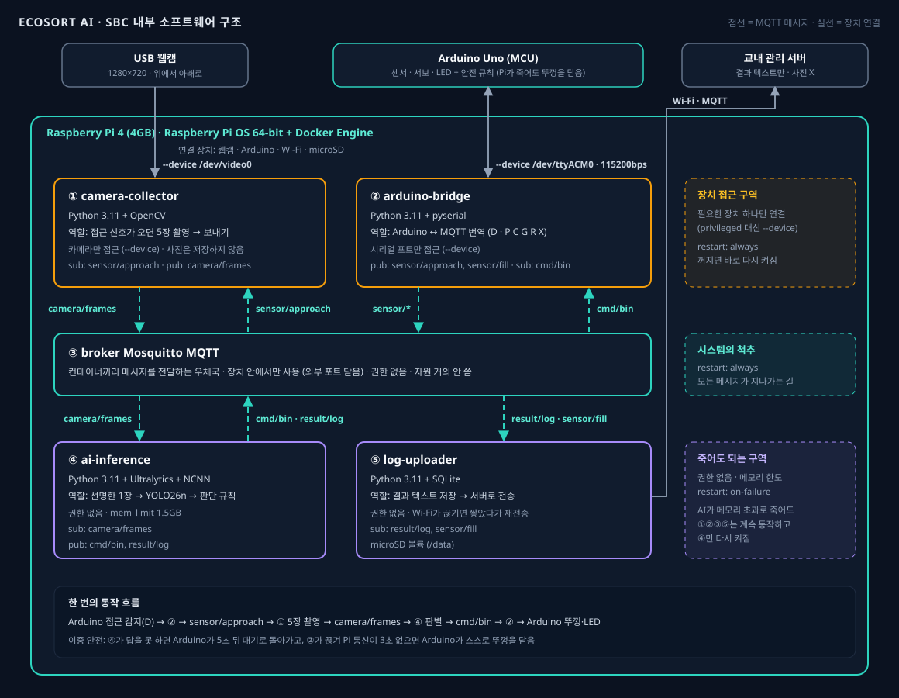

# SBC 컨테이너 구조 보고서 — AI 분리수거 도우미 스마트 쓰레기통

- 작성자: 이수민
- 작성일: 2026-10-16
- 관련 문서: report/sbc_mcu_selection.md (SBC·MCU 부품 선정), report/hardware.md, report/inference_engine.md
- 대상 SBC: Raspberry Pi 4 (4GB) · Raspberry Pi OS 64-bit + Docker Engine
- 결론: SBC 안의 코드를 **도커 컨테이너 5개**로 나누고, 컨테이너끼리는 **MQTT 브로커**로만 메시지를 주고받는다. AI 컨테이너가 죽어도 나머지는 계속 동작하며, 뚜껑 안전은 MCU(Arduino)가 따로 책임진다.

---

## 1. 전체 구조



## 2. 왜 나누는가

AI 추론은 메모리를 많이 써서 가끔 죽을 수 있다. 모든 코드가 한 프로그램이면, AI가 죽을 때 Arduino와의 통신과 서버 기록까지 같이 멈춘다. 그래서 Pi 안의 코드를 역할별로 **도커 컨테이너** 5개로 나누고, "꺼지면 안 되는 것"과 "꺼져도 되는 것"을 구분한다. 컨테이너끼리는 직접 대화하지 않고 **MQTT 브로커**를 통해 메시지를 보내고(pub) 받는다(sub).

## 3. 컨테이너 5개

**① camera-collector**: 접근 신호(`sensor/approach`)를 받으면 웹캠으로 5장을 연속 촬영해 `camera/frames`로 보낸다. 웹캠 장치(`/dev/video0`) 하나에만 접근하며, 사진은 디스크에 저장하지 않고 메시지로만 전달한다. 꺼지면 바로 다시 켜진다(restart: always).

**② arduino-bridge**: Arduino와 USB 시리얼(115200bps)로 대화하는 번역기다. Arduino가 보낸 `D`(접근 감지)와 적재량을 `sensor/approach`, `sensor/fill`로 내보내고, `cmd/bin`으로 온 판단 결과를 `P`/`C`/`G`/`R`/`X` 한 글자로 바꿔 Arduino에 보낸다. 시리얼 포트(`/dev/ttyACM0`) 하나에만 접근하고, 꺼지면 바로 다시 켜진다.

**③ broker**: Mosquitto MQTT 브로커로, 모든 메시지가 지나가는 우체국이다. 장치 안에서만 쓰도록 외부 포트를 열지 않고, 특별 권한이 없으며, 자원을 거의 쓰지 않는다. 시스템의 척추라 꺼지면 바로 다시 켜진다.

**④ ai-inference**: `camera/frames`의 5장 중 가장 선명한 1장을 골라 YOLO26n(NCNN)으로 판별하고, 판단 규칙(물체 없음 · 여러 개 · 흐림 · 신뢰도 0.7)을 거쳐 결과를 `cmd/bin`과 `result/log`로 보낸다. 특별 권한이 없고 메모리 한도(1.5GB)를 걸어, 메모리를 너무 쓰면 이 컨테이너만 멈추고 다시 켜진다(restart: on-failure).

**⑤ log-uploader**: `result/log`(시간, 결과, 신뢰도, 처리 시간)와 `sensor/fill`(적재량)을 microSD의 SQLite에 저장하고 Wi-Fi로 교내 관리 서버에 보낸다. Wi-Fi가 끊기면 쌓아 두었다가 다시 연결되면 보낸다. 특별 권한이 없고, 실패했을 때만 다시 켜진다.

## 4. 메시지(토픽) 정리

`sensor/approach`는 ② → ①, Arduino가 사람 접근을 감지했다는 신호다. `camera/frames`는 ① → ④, 촬영한 5장이다. `cmd/bin`은 ④ → ②, 투입구 안내 명령이다. `result/log`는 ④ → ⑤, 판별 결과 텍스트다. `sensor/fill`은 ② → ⑤, 칸별 적재율이다.

## 5. 권한을 최소로 준 이유

강의 예시는 장치를 다루는 컨테이너에 `privileged`를 주었지만, 이 제품은 `privileged` 대신 **필요한 장치 하나만** 연결하는 `--device`를 쓴다. `privileged`는 컨테이너에 Pi의 거의 모든 권한을 주기 때문에, 그 컨테이너에 문제가 생기면 Pi 전체가 위험해진다. 카메라 컨테이너는 카메라만, 브리지 컨테이너는 시리얼 포트만 쓰면 충분하다. AI 컨테이너는 아무 장치에도 접근하지 않는다.

## 6. 이중 안전

강의 예시에서는 모터 제어와 비상정지가 SBC 안의 컨테이너(②)였지만, 이 제품은 뚜껑 제어와 안전 규칙을 **Arduino(MCU)**에 두었다. 그래서 안전이 두 겹이다. ④ AI가 죽어서 답을 못 하면 Arduino가 5초 뒤 스스로 대기 상태로 돌아간다. ② 브리지가 죽거나 Pi 전체가 멈춰 통신이 3초 끊기면 Arduino가 열린 뚜껑을 천천히 닫고 빨간 LED로 오류를 표시한다. Pi 쪽 코드가 어떻게 되든 사람 손이 뚜껑에 끼는 상황은 MCU가 막는다.

## 7. 메모리 계획 (Raspberry Pi 4, 4GB)

운영체제와 도커 약 0.5GB, 브로커 약 0.01GB, camera-collector 약 0.15GB, arduino-bridge 약 0.05GB, ai-inference 약 0.6~0.9GB(한도 1.5GB), log-uploader 약 0.05GB로 합계 약 2GB 이하다(가정). 4GB의 절반 정도라 여유가 있다.

## 8. docker-compose 예시

```yaml
services:
  broker:
    image: eclipse-mosquitto:2
    restart: always
    volumes:
      - ./mosquitto.conf:/mosquitto/config/mosquitto.conf:ro   # 장치 안에서만 사용

  camera-collector:
    build: ./camera-collector
    restart: always
    devices:
      - /dev/video0:/dev/video0        # 웹캠 하나만
    depends_on: [broker]

  arduino-bridge:
    build: ./arduino-bridge
    restart: always
    devices:
      - /dev/ttyACM0:/dev/ttyACM0      # Arduino 시리얼 하나만
    depends_on: [broker]

  ai-inference:
    build: ./ai-inference
    restart: on-failure
    mem_limit: 1.5g                    # 메모리 한도
    depends_on: [broker]

  log-uploader:
    build: ./log-uploader
    restart: on-failure
    volumes:
      - ./data:/data                   # SQLite 저장 위치 (microSD)
    depends_on: [broker]
```

---

## 9. 다른 문서에 반영할 점

code/preprocess_code.py의 `infer` 명령은 지금 한 프로그램 안에서 촬영·추론·시리얼 통신을 모두 하는데, 이 구조에 맞춰 ①·②·④ 세 컨테이너로 나누는 작업이 다음 단계다.
